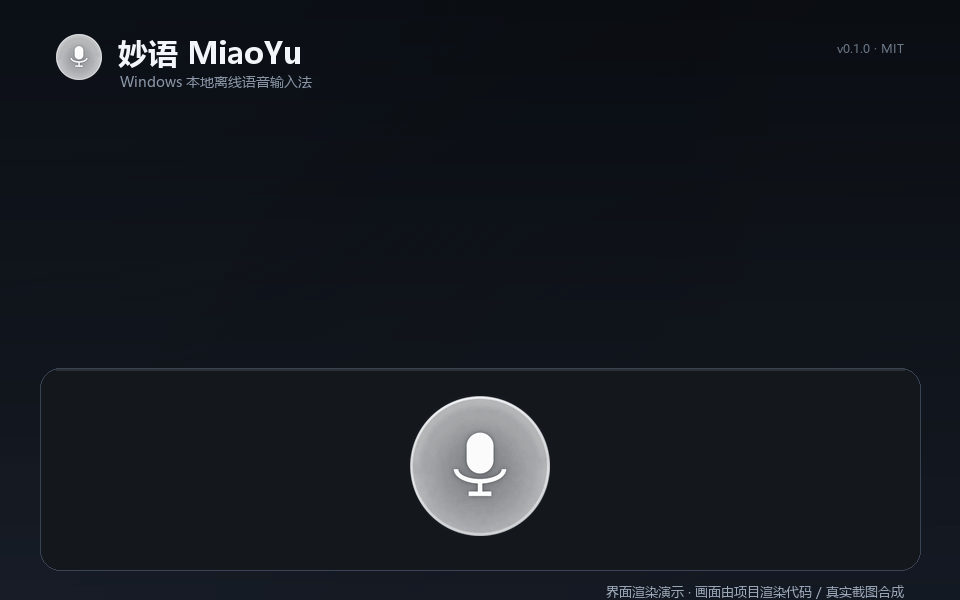
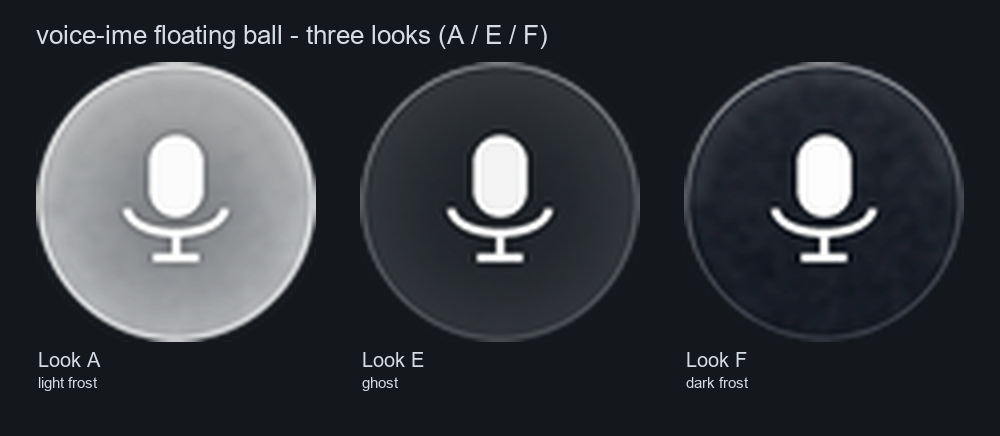
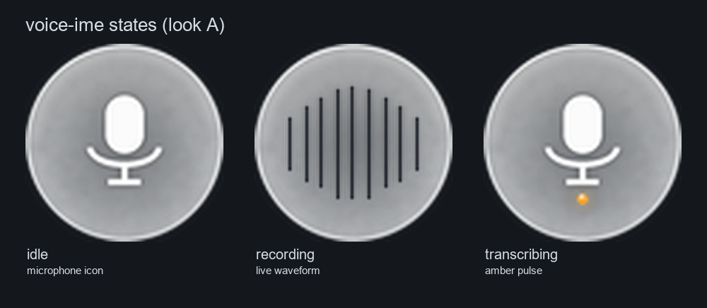
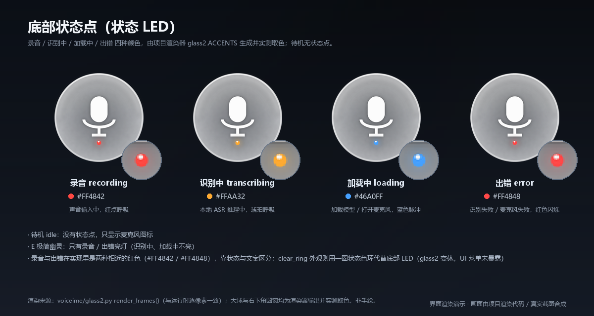
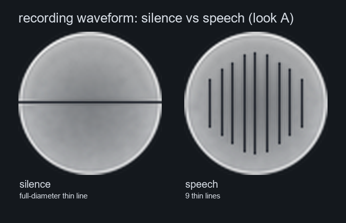
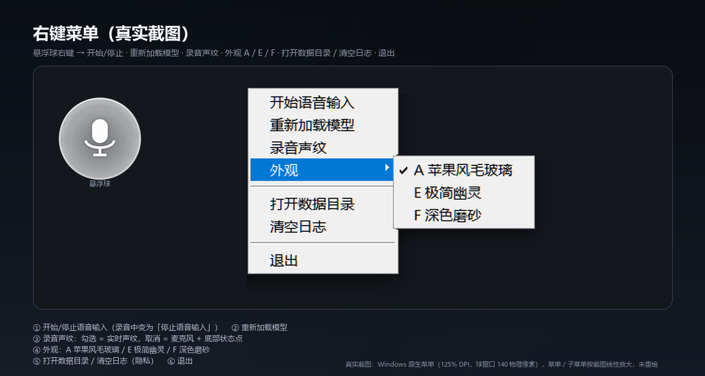
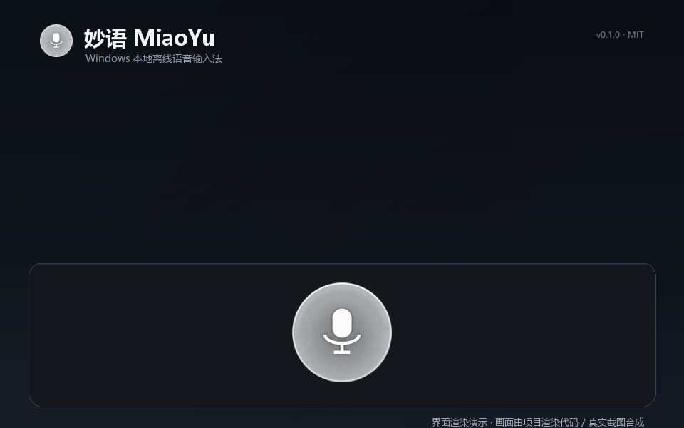

# 妙语 MiaoYu · Windows 本地离线语音输入法

> **As you say, it's typed.**
>
> 按一下热键（或点一下悬浮球）说句话，文字自动出现在当前窗口。
> 识别全程在本机完成（sherpa-onnx + SenseVoice），不联网、不上传音频。

[](LICENSE)
[](#-从源码运行)
[](#-隐私)
[](#-从源码运行)

**[⬇ 下载 Windows 版](https://github.com/BJ939/miaoyu-voice-ime/releases/latest)** ·
[从源码运行](#-从源码运行) ·
[English](README_EN.md)



> 演示画面由项目自身的渲染代码生成（界面渲染演示），其中识别文本来自真实 ASR 输出。

## ✨ 特性

- ⌨️ **全局热键 / 悬浮球**：`Ctrl+Alt+Space` 或单击小球开始/结束录音，`Esc` 取消本次录音。
- 🔒 **全本地离线**：SenseVoice（INT8 ONNX，sherpa-onnx）+ Silero VAD 分段，纯 CPU 推理，
  程序不发起任何网络请求，音频不出本机。
- 🎙️ **常驻麦克风**：启动即后台采集，按热键零开麦延迟、不吞第一个字；空闲 120 秒自动释放设备。
- 📝 **注入焦点窗口**：默认剪贴板粘贴（可恢复原剪贴板），兼容大多数编辑器 / 浏览器 / 聊天窗口；
  可切逐字符 Unicode 输入兜底。
- 🫧 **真透明悬浮球**：Win32 分层窗口逐像素 alpha（能透出桌面壁纸），球外区域点击穿透、不抢焦点。
- 🎨 **三套外观**：A 苹果风毛玻璃 / E 极简幽灵 / F 深色磨砂，右键菜单实时切换并记忆选择。
- 🔊 **录音实时声纹**：录音时麦克风图标变成 9 根随声压起伏的 1px 细线，静音时压成一条横线（约 30fps）。
- 💡 **冷启动过场提示**：冷启动重新开麦先提示「正在打开麦克风，请稍候…」，就绪时气泡变
  「可以说话了」+ 一声很轻的提示音——不会把“开麦中”当成卡死直接开口丢字；暖启动不打扰，
  可用 `ui.ready_chime` 关提示音。
- 🔁 **单实例运行 / 开机自启 / 滚动日志**：PyInstaller 打包，免 Python 分发。

## 🖥 界面与状态

三套外观（A 苹果风毛玻璃 / E 极简幽灵 / F 深色磨砂）：



| 状态 | 悬浮球表现 |
|---|---|
| idle 待机 | 显示麦克风图标（A 玻璃球 / E 幽灵 / F 深色磨砂） |
| recording 录音中 | 麦克风消失，改为实时声纹（静音 = 满直径细平线，有声 = 细线起伏） |
| transcribing 识别中 | 琥珀色呼吸 / 旋转 |
| loading 加载模型 / 开麦中 | 蓝色脉冲 + 「正在打开麦克风，请稍候…」气泡 |
| error 出错 | 红色闪烁 + 短气泡提示 |



状态灯颜色（待机无状态点；录音红 / 识别琥珀 / 加载蓝 / 出错红）：



悬浮球底部的小状态灯用颜色指示当前状态：**录音红 / 识别琥珀 / 加载蓝 / 出错红**（待机时不显示状态点）。
关闭「录音声纹」后，录音中仍保留麦克风图标，由底部状态灯指示状态。

录音声纹（静音 vs 说话）：



## 🎬 30 秒上手（下载版）

### 选哪个包？

到 [Releases](https://github.com/BJ939/miaoyu-voice-ime/releases/latest) 下载最新版 zip：

| 包 | 内容 | 适合谁 |
|---|---|---|
| `MiaoYu-v0.1.0-win-x64-full.zip` | 程序 + ffmpeg + **内置 SenseVoice 模型（含 VAD）** + 第三方许可文件 | **推荐**：下载解压就能用，不用折腾模型 |
| `MiaoYu-v0.1.0-win-x64-lite.zip` | 程序 + ffmpeg，**不含模型** | 已经有一份模型、或想自己管理模型/换精度的人 |

> 完整包约 350 MB（模型约 230 MB）；精简包不含模型、体积小得多。
> 文件大小与 SHA256 以 Release 页面为准。

### 步骤

1. **下载**：上面表格里的任一 zip，放到本地磁盘。
2. **解压前先解除锁定**（Windows 对“下载的压缩包”会加安全标记）：
   右键 zip → **属性** → 勾选「解除锁定」→ 确定。
3. **解压**到任意有写权限的目录（例如 `D:\Apps\MiaoYu\`），**不要**放在
   `C:\Program Files\` 等需要管理员权限的目录（配置与日志写在程序目录旁）。
4. **双击 `MiaoYu.exe`** → 屏幕右侧出现悬浮球（默认约屏幕高度 42% 处）。
5. **允许麦克风**：Windows 设置 → 隐私和安全性 → 麦克风 → 打开「麦克风访问」并允许桌面应用访问。
6. **开始说话**：按 `Ctrl+Alt+Space`（或单击悬浮球）→ 说话 → 再按一次结束 →
   文字自动粘贴进当前光标所在的输入框。

精简包需要先准备模型（任选其一）：

- **手动下载（推荐，不需要 Python）**：从 [sherpa-onnx 官方 `asr-models` 发布页](https://github.com/k2-fsa/sherpa-onnx/releases/tag/asr-models)
  下载 `sherpa-onnx-sense-voice-zh-en-ja-ko-yue-int8-2024-07-17.tar.bz2`，把解包出的
  `model.int8.onnx`、`tokens.txt` 放进 `models\`，再把同页的 `silero_vad.onnx` 放进
  `models\silero\`（详见下面「模型准备」）；
- 已有模型目录时，在 `config.json` 的 `model_dir` 指向它；
- 已装 Python 和本仓库源码时，运行 `python -B scripts\prepare_model.py --from <模型目录>` 复制；
- 运行时若提示找不到模型，`MiaoYu.exe --check` 会给出具体缺失项。

## 🖱 使用

| 操作 | 方式 |
|---|---|
| 开始 / 结束录音 | `Ctrl+Alt+Space`，或**鼠标单击悬浮球** |
| 取消本次录音 | `Esc`（丢弃，不识别不输入） |
| 退出程序 | `Ctrl+Alt+Q`，或右键悬浮球 → 退出 |
| 拖动悬浮球 | 按住左键拖动（移动 > 4px 算拖动，不触发录音），位置会记住 |
| 切换外观 | 右键悬浮球 → 外观 → A 苹果风毛玻璃 / E 极简幽灵 / F 深色磨砂 |
| 开关录音声纹 | 右键悬浮球 → 录音声纹（勾选项） |
| 打开数据目录 / 清空日志 | 右键悬浮球 → 打开数据目录 / 清空日志 |





- 单击悬浮球**不会抢走焦点**：识别结果仍然输入到你击球前正在编辑的窗口。
- 录音中悬浮球变为实时声纹：静音时是一条横跨球体的细平线，说话时 9 根细线随音量起伏
  （浅色外观用深色细线、深色外观用白色细线，保证看得清）。
- 悬浮球每 2 秒自动重新置顶，鼠标移上去也立即置顶，避免被其他置顶窗口遮挡。

### 命令行

```powershell
MiaoYu.exe --check          # 环境自检：模型 / ffmpeg / 麦克风 / 剪贴板
MiaoYu.exe --file a.wav     # 离线识别一个 WAV 文件（调试）
MiaoYu.exe --file a.wav --insert   # 识别后直接注入当前焦点窗口
MiaoYu.exe --status         # 是否已有实例在运行（运行中退出码 0）
MiaoYu.exe --toggle         # 通知运行中的实例开始/停止录音（调试/自动化）
MiaoYu.exe --quit           # 通知运行中的实例退出
MiaoYu.exe --no-ui          # 不显示悬浮球
MiaoYu.exe --console        # 日志同时输出到控制台
```

## 📦 模型准备

模型文件（SenseVoice INT8 ONNX，约 230 MB）**不在 Git 仓库内**。开源仓库只含代码；
官方 Release 的 `full` 包已内置模型，`lite` 包与源码运行需要自行准备。

目录结构（`models\` 与 `MiaoYu.exe` 同级）：

```
models/
  model.int8.onnx      # 或 model.onnx / model.fp32.onnx
  tokens.txt
  silero/
    silero_vad.onnx    # 可选但强烈建议：没有 VAD 时环境底噪可能被识别成幻觉文本
```

三种方式任选其一：

1. **从已有目录复制**（只复制，不联网；适合本机已经有一份模型的开发者）：

   ```powershell
   python -B scripts\prepare_model.py --from D:\somewhere\sensevoice-onnx   # 从指定目录复制
   python -B scripts\prepare_model.py --from D:\somewhere\sensevoice-onnx --dry-run  # 只打印计划
   python -B scripts\prepare_model.py --check    # 只检查 models/ 是否已就绪
   python -B scripts\prepare_model.py --from D:\somewhere\sensevoice-onnx --force  # 覆盖同名文件
   ```

2. **手动放置**：按上面的目录结构把模型文件拷进 `models\`。

3. **复用已有目录**：在 `config.json` 里设置 `"model_dir": "D:\\models\\sensevoice"`
   （优先级最高）。

**模型文件从哪来**（链接于 2026-10-31 实测可访问）：

- **ONNX 下载（推荐）**：[sherpa-onnx 官方模型发布页 `asr-models`](https://github.com/k2-fsa/sherpa-onnx/releases/tag/asr-models)
  → `sherpa-onnx-sense-voice-zh-en-ja-ko-yue-int8-2024-07-17.tar.bz2`，解包即得到
  `model.int8.onnx` + `tokens.txt`；VAD 用同页的 `silero_vad.onnx`。
- **上游权重**：[FunAudioLLM/SenseVoice](https://github.com/FunAudioLLM/SenseVoice)
  （ModelScope `iic/SenseVoiceSmall`）；如需其他精度或自建输入形状，可自行导出 ONNX。
- **许可**：sherpa-onnx [Apache-2.0](https://github.com/k2-fsa/sherpa-onnx)；
  SenseVoice 代码 [MIT](https://github.com/FunAudioLLM/SenseVoice)；
  SenseVoice **模型权重** [FunASR Model License v1.1](https://github.com/modelscope/FunASR/blob/main/MODEL_LICENSE)
  （允许使用/修改/分享，但**必须署名来源**）；Silero VAD [MIT](https://github.com/snakers4/silero-vad)。
- 本仓库**不附带、不下载**模型；`prepare_model.py` 只在本地复制，不联网。

## ⚙️ 配置（`config.json`）

程序退出时自动写回；首次启动使用默认值。配置文件与 `MiaoYu.exe` 同级。
完整默认值见 [`voiceime/config.py`](voiceime/config.py) 与 [设计文档](docs/DESIGN.md)。常用项：

| 键 | 默认 | 说明 |
|---|---|---|
| `hotkey` | `ctrl+alt+space` | 切换录音（支持 ctrl/alt/shift/win + 字母/数字/space/esc/tab） |
| `cancel_key` | `esc` | 录音中取消 |
| `quit_hotkey` | `ctrl+alt+q` | 退出 |
| `mic_device` | `null` | `null`=自动取第一个输入设备；也可填设备名 |
| `warm_mic` | `true` | 麦克风常驻（关掉则每次现开，多约 0.7~1.4s 延迟） |
| `warm_mic_idle_seconds` | `120` | 空闲多久释放麦克风；0=不释放 |
| `warm_mic_buffer_seconds` | `180` | 环形缓冲保留时长（需 ≥ `max_record_seconds`） |
| `ffmpeg_path` | `null` | 指定 ffmpeg.exe 绝对路径；`null` 时用 PATH |
| `language` | `auto` | `auto/zh/en/yue/ja/ko` |
| `use_itn` / `num_threads` | `true` / `2` | 数字标点规范化 / CPU 线程数 |
| `model_dir` / `vad_model` | `null` | 自定义模型目录 / VAD 模型路径 |
| `insert_mode` | `paste` | `paste`（剪贴板粘贴）或 `type`（逐字符输入） |
| `restore_clipboard` | `true` | 粘贴后恢复原剪贴板文本 |
| `paste_delay_ms` / `restore_delay_ms` | `60` / `350` | 粘贴与恢复剪贴板的等待 |
| `max_record_seconds` / `min_record_seconds` | `60` / `0.4` | 单次最长录音 / 误触阈值 |
| `preload_model` | `true` | 启动即加载模型 |
| `log_transcript` | `false` | 日志是否记录识别文本：**默认 false（日志不记录识别文本）**，只记文本长度 |
| `log_level` | `info` | 日志级别（`logs\app.log`，滚动 1MB×3） |
| `ui.*` | — | `always_on_top`、`pos_x/pos_y`、`opacity`、`scale`、`look`(A/E/F)、`waveform`(默认 `true`)、`ready_chime`(默认 `true`，冷启动就绪提示音) |

## 🧪 从源码运行

### 环境要求

| 项目 | 要求 |
|---|---|
| 系统 | Windows 10/11 x64（**仅 Windows**：依赖 dshow、分层窗口、SendInput） |
| Python | 3.10+（开发与验收使用 3.14.x；tkinter 随官方安装包自带） |
| Python 包 | Pillow、numpy、pynput、sherpa-onnx（见 `requirements.txt`） |
| ffmpeg | 需在 PATH 中，或在 `config.json` 的 `ffmpeg_path` 指定 |
| 麦克风 | 任意 dshow 音频输入设备（默认自动取第一个，可用 `mic_device` 指定） |
| 模型 | SenseVoice ONNX + tokens（约 230 MB，**不随仓库分发**，见「模型准备」） |

### 运行

```powershell
# 1) 获取源码：git clone 本仓库，或下载源码 ZIP 解压
cd miaoyu-voice-ime

# 2) 安装 Python 依赖
python -m pip install -r requirements.txt

# 3) 确认 ffmpeg 可用（未安装的话先安装 ffmpeg 并加入 PATH）
ffmpeg -version

# 4) 准备本地模型（见上一节）
python -B scripts\prepare_model.py

# 5) 环境自检：模型 / ffmpeg / 麦克风 / 剪贴板
python -B app.py --check

# 6) 启动悬浮球（带控制台日志）；或双击 run_voiceime.vbs 静默启动
python -B app.py
```

启动后屏幕右侧出现悬浮球，模型加载约 1 秒，之后按 `Ctrl+Alt+Space` 即可说话。
`python -B app.py --no-ui` 只保留全局热键、不显示悬浮球。

## 🛠 构建 EXE

```powershell
python -m pip install pyinstaller
pwsh -File build\build_exe.ps1
```

产物为 PyInstaller **onedir** 形态：`build\dist\MiaoYu\` 下 `MiaoYu.exe` 与 `_internal\`
依赖目录必须放在一起（整个文件夹可打包成 zip 分发）；脚本会自动同步到 `Release\`
（保留已有的 `config.json` / `logs`）。`build\generate_icon.py` 会用同一套渲染代码重新生成
`build\icon.ico`（多尺寸）。

面向维护者的**发布包打包脚本**：`build\package_release.ps1`（生成 `full` / `lite` 两个 zip，
含 ffmpeg LGPL 构建、模型、`THIRD_PARTY_LICENSES` 与 `PROVENANCE`，并输出 `SHA256SUMS.txt`；
需要自备 LGPL 构建的 ffmpeg 与模型文件）。

## ✅ 测试

测试脚本用 `python -B tests\<script>.py` 运行（工作目录 = 项目根）。按环境依赖分三档：

| 档位 | 脚本 | 说明 |
|---|---|---|
| **无需麦克风 / 模型** | `test_ready_signal.py`、`test_privacy.py` | 纯逻辑，可直接跑 |
| **需要交互桌面**（不需要麦克风/模型） | `test_hotkey.py`、`test_inject.py`、`test_ui_click.py` | 全局热键 / 剪贴板 / 悬浮球交互 |
| **需要麦克风** | `test_audio.py`、`test_warm_capture.py`、`test_ui_waveform.py` | 真实录音与声纹（`test_warm_capture` 还需扬声器） |
| **需要模型** | `test_asr.py`、`test_e2e.py` | 识别正确性 / VAD / RTF / 离线识别 |
| **需要模型 + 麦克风** | `test_app_flow.py` | 真 app 进程 + 热键 + 识别 + 注入 |
| **辅助** | `make_fixtures.py` | 用 Windows SAPI 重新生成测试音频 |

注意：

- GUI / 集成测试会启动源码版悬浮球并**抢焦点**，运行前先退出已运行的实例
  （`MiaoYu.exe --quit` 或 `python -B app.py --quit`）——单实例互斥体是同机全局的；
  测试期间避免操作鼠标键盘。
- 麦克风/扬声器不可用的用例会打印 `SKIP`（**不会假装 PASS**）。
- 测试夹具已在 `tests\fixtures\`；缺失时 `test_asr.py` 会自动调用 Windows SAPI 生成
  （需中文/英文语音包）。
- 默认路径下识别测试断言实时率 RTF < 0.5（1 秒音频识别耗时 < 0.5 秒，纯 CPU）。

## 🔒 隐私

- **音频不出本机**：识别、VAD、界面渲染全部在本机完成，程序不发起任何网络请求。
- **音频不落盘**（默认路径）：常驻麦克风采集的音频只存在内存环形缓冲（默认 180 秒）里，
  按热键切片后直接送识别；回退的按需录音路径会短暂写入系统临时目录的 WAV，识别完成后立即删除。
- **日志默认不记录识别文本**：`log_transcript` 默认 `false`，日志只记文本长度、不记内容；
  需要排错时可临时设为 `true`，用完改回。右键菜单提供「清空日志」。
- **首次运行隐私说明**：第一次启动会展示一次隐私说明（音频只在本机处理、默认不写识别文本），
  之后不再打扰。
- **本地数据**：配置 `config.json`、日志 `logs\`、模型 `models\` 都在程序目录，可随时删除；
  这三类文件不会被提交进 Git 仓库。
- 剪贴板仅在被注入的瞬间写入；`restore_clipboard=true`（默认）时粘贴后恢复原文本，
  原内容非文本时不覆盖恢复。

## ⚠️ 已知限制

- **仅 Windows 10/11 x64**：依赖 dshow 采集、Win32 分层窗口与 SendInput，不支持 macOS / Linux。
- **管理员权限窗口**：Windows UIPI 会拦截普通进程向提权窗口发送粘贴/按键；要往以管理员运行的
  程序输入，本工具也需以管理员启动。
- **粘贴兼容性**：少数应用（密码框、部分全屏游戏、远程桌面、某些终端）不响应模拟 `Ctrl+V`；
  可改 `insert_mode: "type"`，但安全输入框仍然无效。
- **剪贴板恢复**：只恢复文本型剪贴板；粘贴前剪贴板里若是图片等非文本内容则不恢复（避免破坏数据）。
- **多显示器 / DPI**：悬浮球拖动范围基于主屏；主副屏缩放不同时保存位置可能有偏移。
- **资源占用**：纯 CPU 推理，模型常驻内存约 300 MB；首次加载模型约 1 秒。
- **分层窗口回退**：极少数环境下真透明创建失败会自动回退色键方案（观感与录音声纹功能降级，
  不会崩溃）。
- **EXE 未代码签名**：Windows SmartScreen 可能提示「Windows 已保护你的电脑」。
  这是未签名程序的正常提示——点「**更多信息**」→「**仍要运行**」即可；
  也可以在 PowerShell 里校验下载文件的 SHA256 是否与 Release 页的 `SHA256SUMS.txt` 一致：

  ```powershell
  Get-FileHash .\MiaoYu-v0.1.0-win-x64-full.zip -Algorithm SHA256
  ```

  发布包 SHA256：见 Release 页 `SHA256SUMS.txt`（下载后可用上方命令校验）。

## 📄 第三方许可与免责声明

- **本项目代码与文档**：[MIT](LICENSE) © 2026 妙语 (MiaoYu) contributors。
  MIT 许可**仅覆盖本仓库中的代码与文档**，不覆盖模型权重与第三方组件。
- **语音识别模型**：SenseVoice 权重版权归 **Alibaba / FunAudioLLM**，遵循
  [FunASR Model License v1.1](https://github.com/modelscope/FunASR/blob/main/MODEL_LICENSE)，
  使用/分发须署名来源；本仓库使用的 ONNX 版本由 [k2-fsa/sherpa-onnx](https://github.com/k2-fsa/sherpa-onnx)
  转换并发布。本项目与 Alibaba / FunAudioLLM / k2-fsa 无隶属关系。
- **sherpa-onnx**：Apache-2.0；**Silero VAD**：MIT；**numpy**：BSD-3-Clause；
  **Pillow**：MIT-CMU；**pynput**：LGPLv3（以依赖方式引入）。
- **ffmpeg**：发布包内置的是 **LGPL 构建**的 ffmpeg（不随 Git 仓库分发），用于 dshow 采集；
  其许可与源码获取方式见发布包内 `THIRD_PARTY_LICENSES` 与 `PROVENANCE` 文件。
  从源码运行时请自行安装 ffmpeg；若要再分发 ffmpeg，必须遵守 LGPL（附许可与源码链接）。
- **测试音频**：`tests/fixtures/*.wav` 由 Windows SAPI 语音合成生成，仅用于测试，不含真人录音。
- **免责声明**：本软件按「现状」提供，不附带任何明示或暗示担保；识别准确率受环境、口音、
  麦克风影响，作者不对识别错误、数据丢失或对本机系统的影响承担责任。使用模型与 ffmpeg
  请遵守相应许可；请勿将本工具用于违反当地法律法规的用途。

## 🤖 让 AI 帮你装

不想自己折腾？把下面这段整段复制给任意 AI 助手（ChatGPT / Claude / 豆包 / Kimi 等），
让它一步步带你装：

```text
我是 Windows 10/11 用户，想安装并使用开源本地语音输入工具「妙语 MiaoYu」。
项目地址：https://github.com/BJ939/miaoyu-voice-ime
请按下面步骤帮我，每步先说明你要做什么、等我确认后再执行：
1. 打开 Releases 页面（/releases/latest），告诉我该下载 MiaoYu-v0.1.0-win-x64-full.zip
   还是 MiaoYu-v0.1.0-win-x64-lite.zip（我不想自己找模型，推荐我下哪个）；
2. 指导我下载后先“右键 zip → 属性 → 解除锁定”，再解压到 D:\Apps\MiaoYu\；
3. 解压后确认目录里有 MiaoYu.exe、_internal\（完整包还有 models\），不要启动未知的 exe；
4. 确认 Windows 麦克风权限已打开（设置 → 隐私和安全性 → 麦克风）；
5. 让我双击 MiaoYu.exe，用 Ctrl+Alt+Space 说一句话，确认文字进入记事本；
6. 如果 SmartScreen 拦截，告诉我如何点“更多信息 → 仍要运行”；
7. 如果识别失败，让我运行 MiaoYu.exe --check 并把错误信息发给你判断。
不要下载模型以外的文件，不要改我的系统设置或注册表。
```

## ❓ FAQ

**Q：按热键没反应 / 麦克风没声音？**
先确认 Windows 麦克风权限（设置 → 隐私和安全性 → 麦克风 → 允许桌面应用访问）；
再运行 `MiaoYu.exe --check` 查看麦克风与模型状态；多个输入设备时可在 `config.json`
用 `mic_device` 指定设备名。

**Q：Windows SmartScreen / 杀毒软件报毒怎么办？**
EXE 未做代码签名，PyInstaller 产物可能被 SmartScreen 或杀软误报。点「更多信息 → 仍要运行」；
用 `Get-FileHash` 对比 Release 页的 SHA256；不放心可自行从源码构建。

**Q：热键和其他软件冲突？**
改 `config.json` 的 `hotkey`（例如 `"ctrl+alt+f9"`）；也可以完全不用热键，直接单击悬浮球。

**Q：模型应该放在哪？**
`models\`（与 `MiaoYu.exe` 同级），或 `config.json` 里用 `model_dir` 指向任意已有模型目录。
完整包已内置模型，无需处理。

**Q：断网能用吗？会联网吗？**
能。识别、VAD、界面全部本地完成，程序不发起任何网络请求；装好模型后完全离线可用。

**Q：识别不准？**
在 `config.json` 设 `language` 为 `zh`（中文）或 `en` 等；尽量用质量好的麦克风、距离适中、
环境安静；VAD 模型缺失时底噪可能被误识别，建议补齐 `models\silero\silero_vad.onnx`。

**Q：日志在哪？里面会不会有我说的话？**
日志在程序目录 `logs\app.log`，默认**不记录识别文本**（`log_transcript=false`）；
右键菜单「打开数据目录」可直接打开，「清空日志」可清空。

**Q：怎么卸载？**
退出程序后删除整个程序目录即可；如果装过开机自启，运行
`pwsh -File install_autostart.ps1 -Remove`（需源码目录）或手动删除
`shell:startup` 里的快捷方式。

**Q：支持 macOS / Linux 吗？**
不支持。本项目依赖 Windows 的 dshow 采集、分层窗口与 SendInput，仅面向 Windows 10/11 x64。

## 🙏 致谢

- [sherpa-onnx](https://github.com/k2-fsa/sherpa-onnx)：优秀的离线语音推理框架。
- [SenseVoice / FunAudioLLM](https://github.com/FunAudioLLM/SenseVoice)：高质量的语音识别模型。
- [Silero VAD](https://github.com/snakers4/silero-vad)：轻量可靠的语音活动检测。
- 以及所有为开源语音/桌面工具生态做出贡献的项目与作者。

如果这个项目对你有帮助，欢迎点一个 ⭐ **Star**——这是对独立开发最大的鼓励。

## 📜 License

[MIT](LICENSE) © 2026 妙语 (MiaoYu) contributors

---

设计文档（模块接口、状态机、分层窗口与声纹实现约束、已知边界）：[docs/DESIGN.md](docs/DESIGN.md)
