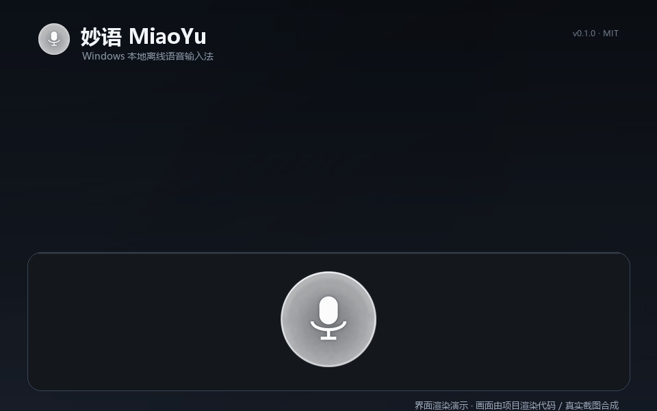
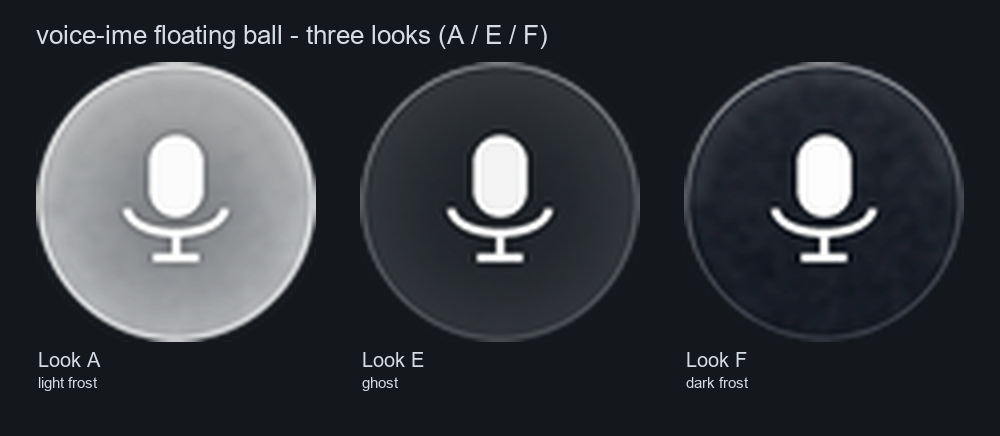
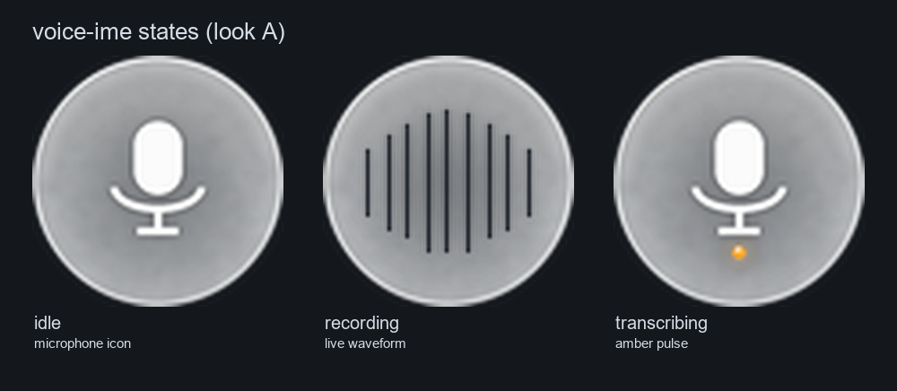
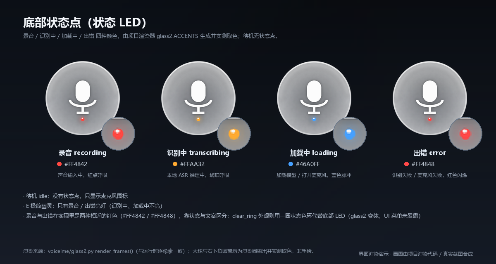
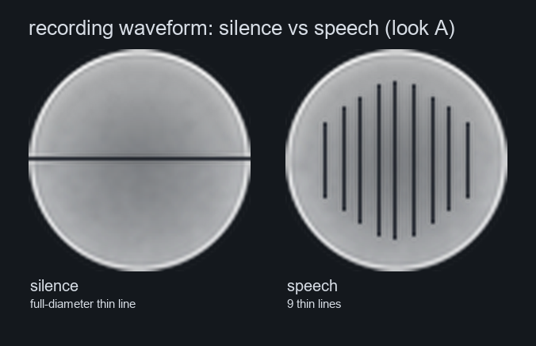
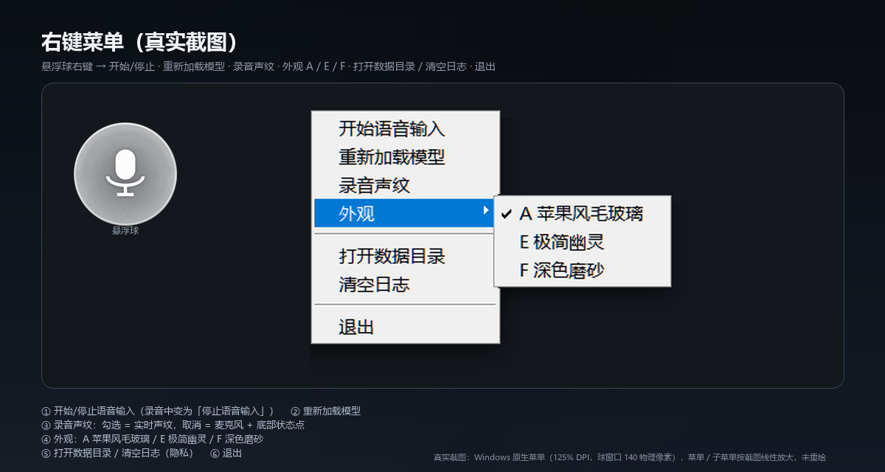
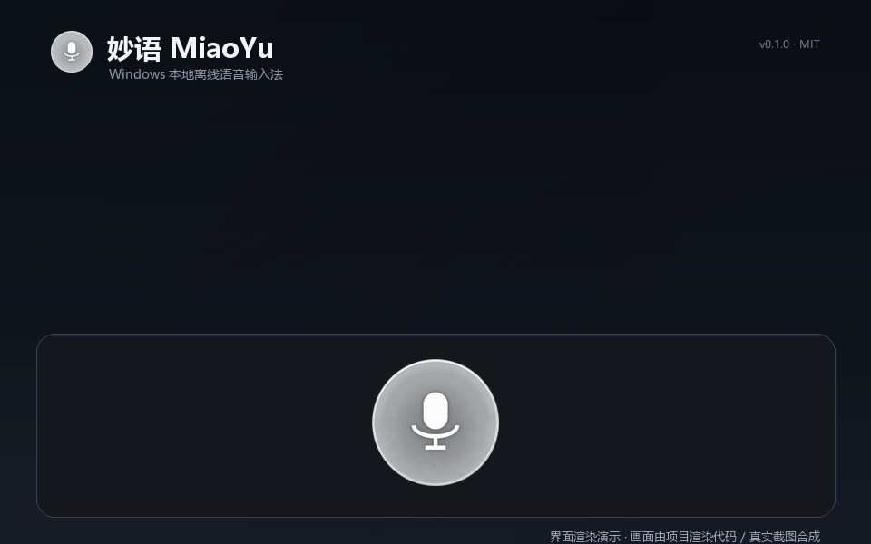

# MiaoYu · Offline Voice Input for Windows

[中文](README.md) | **English**

> **As you say, it's typed.**
>
> Press a hotkey (or click the floating ball), say a sentence, and the text appears in the
> focused window. Speech recognition runs entirely on your machine (sherpa-onnx + SenseVoice) —
> no network, no audio upload.

[](LICENSE)
[](#-run-from-source)
[](#-privacy)
[](#-run-from-source)

**[⬇ Download for Windows](https://github.com/BJ939/miaoyu-voice-ime/releases/latest)** ·
[Run from source](#-run-from-source) ·
[中文](README.md)



> The demo is an interface rendering generated by the project's own rendering code; the recognized
> text comes from real ASR output.

## ✨ Features

- ⌨️ **Global hotkey / floating ball**: start and stop recording with `Ctrl+Alt+Space` or a single
  click on the ball; `Esc` cancels the current recording.
- 🔒 **Fully local, fully offline**: SenseVoice (INT8 ONNX, sherpa-onnx) + Silero VAD segmentation,
  pure CPU inference. The program makes no network requests and audio never leaves your machine.
- 🎙️ **Always-on microphone**: capture starts in the background at launch, so there is no
  "open mic" latency and the first syllable is never swallowed; the device is released after
  120 seconds idle.
- 📝 **Types into the focused window**: clipboard paste by default (with clipboard restore),
  compatible with most editors, browsers and chat windows; a per-character Unicode input mode is
  available as a fallback.
- 🫧 **Truly transparent floating ball**: Win32 layered window with per-pixel alpha (the desktop
  wallpaper shows through), click-through outside the ball, and it never steals focus.
- 🎨 **Three looks**: A – frosted glass, E – minimal ghost, F – dark frosted; switch instantly from
  the right-click menu and your choice is remembered.
- 🔊 **Live recording waveform**: while recording, the microphone icon becomes 9 one-pixel lines
  driven by the audio level; in silence they collapse into one thin line (~30 fps).
- 💡 **Cold-start cue**: when the microphone has to be reopened from cold, a bubble says
  "Opening microphone, please wait…", then "Ready to speak" with a very soft chime — so you never
  mistake a cold start for a freeze and start talking too early. Warm starts stay silent.
  Disable the chime with `ui.ready_chime`.
- 🔁 **Single instance / autostart / rotating logs**: shipped as a PyInstaller bundle, no Python
  required for end users.

## 🖥 Interface and states

Three looks (A frosted glass / E minimal ghost / F dark frosted):



| State | Floating ball |
|---|---|
| idle | microphone icon (A glass ball / E ghost / F dark frosted) |
| recording | microphone disappears, live waveform (silence = full-diameter thin line, speech = moving lines) |
| transcribing | amber breathing / spinning |
| loading / opening mic | blue pulse + "Opening microphone, please wait…" bubble |
| error | red flash + short bubble |



Status LED colors (no status dot when idle; recording red / transcribing amber / loading blue /
error red):



A small status LED at the bottom of the ball indicates the current state:
**recording red / transcribing amber / loading blue / error red** (no status dot when idle).
With "recording waveform" turned off, the microphone icon stays visible while recording and the
bottom LED indicates the state.

Recording waveform (silence vs speech):



## 🎬 30-second quick start (download)

### Which package?

Grab the latest zip from [Releases](https://github.com/BJ939/miaoyu-voice-ime/releases/latest):

| Package | Contents | Best for |
|---|---|---|
| `MiaoYu-v0.1.0-win-x64-full.zip` | program + ffmpeg + **bundled SenseVoice model (with VAD)** + third-party license files | **Recommended**: unzip and go, no model setup |
| `MiaoYu-v0.1.0-win-x64-lite.zip` | program + ffmpeg, **no model** | you already have a model, or want to manage precision/model yourself |

> The full package is about 350 MB (the model is about 230 MB); the lite package contains no model
> and is much smaller. Sizes and SHA256 are as shown on the Release page.

### Steps

1. **Download** either zip above to a local disk.
2. **Unblock before extracting** (Windows tags downloaded archives): right-click the zip →
   **Properties** → check **Unblock** → OK.
3. **Extract** to any writable folder (e.g. `D:\Apps\MiaoYu\`). Do **not** put it under
   `C:\Program Files\` or another folder that needs administrator rights (config and logs are
   written next to the program).
4. **Double-click `MiaoYu.exe`** — the floating ball appears on the right side of the screen
   (about 42% of the screen height by default).
5. **Allow the microphone**: Windows Settings → Privacy & security → Microphone → turn on
   microphone access and allow desktop apps.
6. **Speak**: press `Ctrl+Alt+Space` (or click the ball) → speak → press again to stop →
   the text is pasted into the currently focused input box.

The lite package needs a model first (pick one):

- **Download manually (recommended, no Python needed)**: get
  `sherpa-onnx-sense-voice-zh-en-ja-ko-yue-int8-2024-07-17.tar.bz2` from the
  [sherpa-onnx `asr-models` release page](https://github.com/k2-fsa/sherpa-onnx/releases/tag/asr-models),
  put `model.int8.onnx` and `tokens.txt` into `models\`, and put `silero_vad.onnx` from the same
  page into `models\silero\` (see "Model setup" below);
- if you already have a model directory, point `model_dir` in `config.json` at it;
- with Python and the source scripts available, run
  `python -B scripts\prepare_model.py --from <model_dir>` to copy;
- if the model cannot be found at runtime, `MiaoYu.exe --check` reports exactly what is missing.

## 🖱 Usage

| Action | How |
|---|---|
| start / stop recording | `Ctrl+Alt+Space`, or a **single click** on the floating ball |
| cancel this recording | `Esc` (discarded, not recognized, not typed) |
| quit | `Ctrl+Alt+Q`, or right-click the ball → Quit |
| move the ball | hold the left button and drag (movement > 4 px counts as dragging, not a click); the position is remembered |
| switch look | right-click the ball → Look → A frosted glass / E minimal ghost / F dark frosted |
| toggle recording waveform | right-click the ball → Recording waveform (checkbox) |
| open data folder / clear logs | right-click the ball → Open data folder / Clear logs |





- Clicking the ball **does not steal focus**: the recognized text still goes to the window you were
  editing before clicking.
- While recording, the ball shows the live waveform: one thin full-width line in silence, 9 thin
  lines moving with the level when you speak (dark lines on light looks, white lines on dark looks).
- The ball re-raises itself to the top every 2 seconds (and on mouse-over) so other
  always-on-top windows cannot cover it.

### Command line

```powershell
MiaoYu.exe --check          # environment self-check: model / ffmpeg / microphone / clipboard
MiaoYu.exe --file a.wav     # offline recognition of a WAV file (debug)
MiaoYu.exe --file a.wav --insert   # recognize and insert into the focused window
MiaoYu.exe --status         # is an instance already running? (exit code 0 if running)
MiaoYu.exe --toggle         # tell the running instance to start/stop recording (debug/automation)
MiaoYu.exe --quit           # tell the running instance to quit
MiaoYu.exe --no-ui          # no floating ball
MiaoYu.exe --console        # also print logs to the console
```

## 📦 Model setup

The model files (SenseVoice INT8 ONNX, about 230 MB) are **not included in the Git repository**.
The repository contains code only. The official `full` release package bundles the model; the
`lite` package and running from source require you to prepare it.

Expected layout (`models\` next to `MiaoYu.exe`):

```
models/
  model.int8.onnx      # or model.onnx / model.fp32.onnx
  tokens.txt
  silero/
    silero_vad.onnx    # optional but strongly recommended: without VAD, background noise may be
                       # hallucinated as text
```

Pick one of three ways:

1. **Copy from an existing directory** (copy only, never downloads; handy for developers who
   already have a model):

   ```powershell
   python -B scripts\prepare_model.py --from D:\somewhere\sensevoice-onnx   # copy from a given dir
   python -B scripts\prepare_model.py --from D:\somewhere\sensevoice-onnx --dry-run  # print plan only
   python -B scripts\prepare_model.py --check    # only check whether models/ is ready
   python -B scripts\prepare_model.py --from D:\somewhere\sensevoice-onnx --force  # overwrite same-name files
   ```

2. **Place manually**: copy the model files into `models\` following the layout above.

3. **Reuse an existing directory**: set `"model_dir": "D:\\models\\sensevoice"` in `config.json`
   (highest priority).

**Where to get the model** (links verified on 2026-10-31):

- **ONNX download (recommended)**: [sherpa-onnx official `asr-models` release](https://github.com/k2-fsa/sherpa-onnx/releases/tag/asr-models)
  → `sherpa-onnx-sense-voice-zh-en-ja-ko-yue-int8-2024-07-17.tar.bz2`, which contains
  `model.int8.onnx` + `tokens.txt`; use `silero_vad.onnx` from the same page for VAD.
- **Upstream weights**: [FunAudioLLM/SenseVoice](https://github.com/FunAudioLLM/SenseVoice)
  (ModelScope `iic/SenseVoiceSmall`); export ONNX yourself for other precisions/input shapes.
- **Licenses**: sherpa-onnx [Apache-2.0](https://github.com/k2-fsa/sherpa-onnx);
  SenseVoice code [MIT](https://github.com/FunAudioLLM/SenseVoice);
  SenseVoice **model weights** [FunASR Model License v1.1](https://github.com/modelscope/FunASR/blob/main/MODEL_LICENSE)
  (use/modify/share permitted, but **attribution to the source is required**);
  Silero VAD [MIT](https://github.com/snakers4/silero-vad).
- This repository **does not bundle or download** the model; `prepare_model.py` only copies local
  files and never accesses the network.

## ⚙️ Configuration (`config.json`)

Written back when the program exits; defaults are used on first launch. The config file lives next
to `MiaoYu.exe`. See [`voiceime/config.py`](voiceime/config.py) and the
[design document](docs/DESIGN.md) for the full defaults. Common keys:

| Key | Default | Description |
|---|---|---|
| `hotkey` | `ctrl+alt+space` | toggle recording (ctrl/alt/shift/win + letter/digit/space/esc/tab) |
| `cancel_key` | `esc` | cancel while recording |
| `quit_hotkey` | `ctrl+alt+q` | quit |
| `mic_device` | `null` | `null` = first input device; or a device name |
| `warm_mic` | `true` | keep the microphone open (if disabled, each recording adds ~0.7–1.4 s) |
| `warm_mic_idle_seconds` | `120` | release the microphone after this idle time; 0 = never |
| `warm_mic_buffer_seconds` | `180` | ring-buffer length (must be ≥ `max_record_seconds`) |
| `ffmpeg_path` | `null` | explicit path to ffmpeg.exe; `null` = use PATH |
| `language` | `auto` | `auto/zh/en/yue/ja/ko` |
| `use_itn` / `num_threads` | `true` / `2` | inverse text normalization / CPU threads |
| `model_dir` / `vad_model` | `null` | custom model directory / VAD model path |
| `insert_mode` | `paste` | `paste` (clipboard) or `type` (per-character input) |
| `restore_clipboard` | `true` | restore the previous clipboard text after pasting |
| `paste_delay_ms` / `restore_delay_ms` | `60` / `350` | waits before paste / clipboard restore |
| `max_record_seconds` / `min_record_seconds` | `60` / `0.4` | max recording length / accidental-tap threshold |
| `preload_model` | `true` | load the model at startup |
| `log_transcript` | `false` | whether logs contain recognized text: **default false (no transcript in logs)**, only the text length is logged |
| `log_level` | `info` | log level (`logs\app.log`, rotating 1 MB × 3) |
| `ui.*` | — | `always_on_top`, `pos_x/pos_y`, `opacity`, `scale`, `look` (A/E/F), `waveform` (default `true`), `ready_chime` (default `true`, cold-start chime) |

## 🧪 Run from source

### Requirements

| Item | Requirement |
|---|---|
| OS | Windows 10/11 x64 (**Windows only**: dshow capture, layered windows and SendInput are Win32 APIs) |
| Python | 3.10+ (developed and verified with 3.14.x; tkinter ships with the official installer) |
| Python packages | Pillow, numpy, pynput, sherpa-onnx (see `requirements.txt`) |
| ffmpeg | must be on PATH, or set `ffmpeg_path` in `config.json` |
| Microphone | any dshow audio input device (the first one is used by default; override with `mic_device`) |
| Model | SenseVoice ONNX + tokens (about 230 MB, **not distributed with the repository**, see "Model setup") |

### Run

```powershell
# 1) get the source: git clone this repository, or download and extract the source ZIP
cd miaoyu-voice-ime

# 2) install Python dependencies
python -m pip install -r requirements.txt

# 3) make sure ffmpeg is available (install it and add it to PATH if needed)
ffmpeg -version

# 4) prepare the local model (see the previous section)
python -B scripts\prepare_model.py

# 5) environment self-check: model / ffmpeg / microphone / clipboard
python -B app.py --check

# 6) start with the floating ball (with console logs); or double-click run_voiceime.vbs to run silently
python -B app.py
```

The floating ball appears on the right side of the screen; the model loads in about a second, then
press `Ctrl+Alt+Space` to speak. `python -B app.py --no-ui` keeps only the global hotkey without the
floating ball.

## 🛠 Build the EXE

```powershell
python -m pip install pyinstaller
pwsh -File build\build_exe.ps1
```

The output is a PyInstaller **onedir** build: `build\dist\MiaoYu\` contains `MiaoYu.exe` and the
`_internal\` dependency folder, which must stay together (the whole folder can be zipped for
distribution). The script also syncs the result to `Release\` (keeping an existing `config.json` /
`logs`). `build\generate_icon.py` regenerates `build\icon.ico` (multiple sizes) with the same
rendering code.

For maintainers, the **release packaging script** is `build\package_release.ps1` (builds the `full`
and `lite` zips with the LGPL ffmpeg build, model, `THIRD_PARTY_LICENSES` and `PROVENANCE`, and
writes `SHA256SUMS.txt`; you need to provide the LGPL ffmpeg build and model files).

## ✅ Tests

Run each test with `python -B tests\<script>.py` from the project root. They fall into three
environment tiers:

| Tier | Scripts | Notes |
|---|---|---|
| **No microphone / model needed** | `test_ready_signal.py`, `test_privacy.py` | pure logic, run anywhere |
| **Interactive desktop** (no mic/model) | `test_hotkey.py`, `test_inject.py`, `test_ui_click.py` | global hotkeys / clipboard / floating-ball interaction |
| **Microphone needed** | `test_audio.py`, `test_warm_capture.py`, `test_ui_waveform.py` | real recording and waveform (`test_warm_capture` also needs a speaker) |
| **Model needed** | `test_asr.py`, `test_e2e.py` | recognition accuracy / VAD / RTF / offline decode |
| **Model + microphone** | `test_app_flow.py` | real app process + hotkey + recognition + injection |
| **Helper** | `make_fixtures.py` | regenerate test audio with Windows SAPI |

Notes:

- GUI / integration tests start the source floating ball and **steal focus**; quit any running
  instance first (`MiaoYu.exe --quit` or `python -B app.py --quit`) — the single-instance mutex is
  global on the machine. Avoid using mouse/keyboard while they run.
- Cases that cannot run (no microphone/speaker) print `SKIP` and **never fake PASS**.
- Test fixtures live in `tests\fixtures\`; if missing, `test_asr.py` regenerates them with Windows
  SAPI (Chinese/English voices required).
- The recognition test asserts a real-time factor RTF < 0.5 (1 s of audio takes < 0.5 s to
  recognize, pure CPU).

## 🔒 Privacy

- **Audio never leaves the machine**: recognition, VAD and UI rendering are all local; the program
  makes no network requests.
- **Audio is not written to disk** (default path): the always-on capture lives only in an in-memory
  ring buffer (180 s by default) and is sliced for recognition on demand. The fallback
  record-on-demand path briefly writes a WAV to the system temp directory and deletes it right
  after recognition.
- **Logs do not contain recognized text by default**: `log_transcript` defaults to `false`, so logs
  record only the text length, not its content. Turn it on temporarily for troubleshooting and back
  off afterwards. The right-click menu offers **Clear logs**.
- **First-run privacy notice**: on first launch a one-time notice explains that audio is processed
  locally and transcripts are not logged by default.
- **Local data**: `config.json`, `logs\` and `models\` all live next to the program and can be
  deleted at any time; none of them are committed to Git.
- The clipboard is written only at injection time; with `restore_clipboard=true` (default) the
  previous text is restored after pasting. Non-text clipboard content is never overwritten back.

## ⚠️ Known limitations

- **Windows 10/11 x64 only**: relies on dshow capture, Win32 layered windows and SendInput; macOS
  and Linux are not supported.
- **Elevated windows**: Windows UIPI blocks a normal process from injecting into an elevated window;
  run MiaoYu as administrator if you need to type into such programs.
- **Paste compatibility**: a few apps (password boxes, some full-screen games, Remote Desktop,
  certain terminals) ignore simulated `Ctrl+V`; switch `insert_mode` to `"type"`, though secure
  input boxes still will not work.
- **Clipboard restore**: only text clipboards are restored; if the clipboard held an image, it is
  left untouched (to avoid data loss).
- **Multi-monitor / DPI**: dragging is bounded to the primary screen; with mixed DPI scaling a saved
  position may be slightly off.
- **Resources**: pure CPU inference; the model uses about 300 MB of RAM and loads in about 1 second
  the first time.
- **Layered-window fallback**: on rare machines the truly transparent window cannot be created and
  a color-key fallback is used (slightly different visuals, no recording waveform; no crash).
- **The EXE is not code-signed**: Windows SmartScreen may show "Windows protected your PC". This is
  normal for unsigned binaries — click **More info** → **Run anyway**. You can also verify the
  downloaded file's SHA256 against `SHA256SUMS.txt` on the Release page:

  ```powershell
  Get-FileHash .\MiaoYu-v0.1.0-win-x64-full.zip -Algorithm SHA256
  ```

  Release SHA256: see `SHA256SUMS.txt` on the Release page (verify with the command above).

## 📄 Third-party licenses and disclaimer

- **Project code and documents**: [MIT](LICENSE) © 2026 妙语 (MiaoYu) contributors.
  The MIT license **covers only the code and documents in this repository**, not model weights or
  third-party components.
- **Speech recognition model**: SenseVoice weights are copyright **Alibaba / FunAudioLLM** and are
  distributed under the
  [FunASR Model License v1.1](https://github.com/modelscope/FunASR/blob/main/MODEL_LICENSE);
  attribution to the source is required when using/distributing them. The ONNX version used here is
  converted and published by [k2-fsa/sherpa-onnx](https://github.com/k2-fsa/sherpa-onnx). This
  project is not affiliated with Alibaba / FunAudioLLM / k2-fsa.
- **sherpa-onnx**: Apache-2.0; **Silero VAD**: MIT; **numpy**: BSD-3-Clause;
  **Pillow**: MIT-CMU; **pynput**: LGPLv3 (used as a dependency).
- **ffmpeg**: the release packages bundle an **LGPL build** of ffmpeg (not distributed with the Git
  repository) for dshow capture; its license and source-access information is in the
  `THIRD_PARTY_LICENSES` and `PROVENANCE` files inside the release package. When running from
  source, install ffmpeg yourself; if you redistribute ffmpeg you must comply with the LGPL
  (include the license and a source link).
- **Test audio**: `tests/fixtures/*.wav` are generated with Windows SAPI speech synthesis and are
  used for testing only; they contain no human recordings.
- **Disclaimer**: this software is provided "as is", without any express or implied warranty.
  Recognition accuracy depends on the environment, accent and microphone; the authors are not liable
  for recognition errors, data loss or effects on your system. Follow the licenses of the model and
  ffmpeg, and do not use this tool for unlawful purposes.

## 🤖 Let an AI install it for you

Not comfortable with manual setup? Copy the whole block below to any AI assistant (ChatGPT / Claude
/ Kimi, etc.) and let it walk you through the install:

```text
I am a Windows 10/11 user and I want to install and use the open-source local voice input tool
"MiaoYu". Project: https://github.com/BJ939/miaoyu-voice-ime
Please guide me step by step. Explain what you are about to do and wait for my confirmation:
1. Open the Releases page (/releases/latest) and tell me whether to download
   MiaoYu-v0.1.0-win-x64-full.zip or MiaoYu-v0.1.0-win-x64-lite.zip (I don't want to hunt for a
   model — recommend one);
2. After I download it, tell me to right-click the zip → Properties → Unblock, then extract to
   D:\Apps\MiaoYu\;
3. Check the extracted folder contains MiaoYu.exe and _internal\ (and models\ for the full package);
   do not launch unknown exe files;
4. Make sure Windows microphone access is enabled (Settings → Privacy & security → Microphone);
5. Have me double-click MiaoYu.exe, press Ctrl+Alt+Space, say a sentence, and confirm the text
   appears in Notepad;
6. If SmartScreen blocks it, tell me how to choose "More info → Run anyway";
7. If recognition fails, have me run MiaoYu.exe --check and paste the error output to you.
Do not download anything other than the model files, and do not change my system settings or registry.
```

## ❓ FAQ

**Q: The hotkey does nothing / the microphone is silent.**
Check Windows microphone access (Settings → Privacy & security → Microphone → allow desktop apps),
then run `MiaoYu.exe --check` to inspect microphone/model state. If you have several input devices,
set `mic_device` in `config.json`.

**Q: SmartScreen or antivirus flags the app.**
The EXE is unsigned and PyInstaller builds are sometimes falsely flagged. Choose "More info → Run
anyway"; compare the SHA256 with the Release page; build from source yourself if you prefer.

**Q: The hotkey conflicts with another app.**
Change `hotkey` in `config.json` (e.g. `"ctrl+alt+f9"`), or skip hotkeys entirely and click the ball.

**Q: Where should the model go?**
Into `models\` next to `MiaoYu.exe`, or point `model_dir` in `config.json` at any existing model
directory. The full package already includes the model.

**Q: Does it work offline? Does it connect to the internet?**
Yes, it works offline. Recognition, VAD and UI are all local; the program makes no network requests.

**Q: Recognition accuracy is poor.**
Set `language` to `zh`, `en`, etc.; use a decent microphone, keep a reasonable distance, reduce
background noise. Without the VAD model, background noise may be misrecognized — install
`models\silero\silero_vad.onnx`.

**Q: Where are the logs? Do they contain what I said?**
Logs are in `logs\app.log` next to the program and by default **do not contain recognized text**
(`log_transcript=false`). Right-click → Open data folder / Clear logs.

**Q: How do I uninstall?**
Quit the app and delete the program folder. If you enabled autostart, run
`pwsh -File install_autostart.ps1 -Remove` (from the source folder) or delete the shortcut from
`shell:startup`.

**Q: Does it support macOS / Linux?**
No. It relies on Windows dshow capture, layered windows and SendInput, and targets Windows 10/11 x64.

## 🙏 Acknowledgements

- [sherpa-onnx](https://github.com/k2-fsa/sherpa-onnx) — an excellent offline speech inference framework.
- [SenseVoice / FunAudioLLM](https://github.com/FunAudioLLM/SenseVoice) — a high-quality speech
  recognition model.
- [Silero VAD](https://github.com/snakers4/silero-vad) — lightweight and reliable voice activity
  detection.
- And everyone contributing to the open-source speech/desktop tooling ecosystem.

If this project helps you, please give it a ⭐ **Star** — it means a lot to an independent developer.

## 📜 License

[MIT](LICENSE) © 2026 妙语 (MiaoYu) contributors

---

Design document (module interfaces, state machine, layered-window and waveform constraints, known
boundaries): [docs/DESIGN.md](docs/DESIGN.md)
